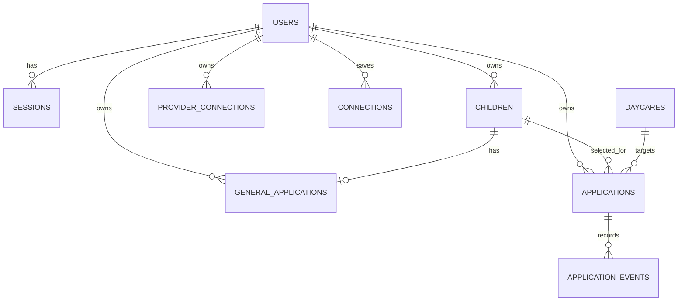

# OneKare MVP schema proposal

This is the lean database design for the current MVP. `users`, `sessions`, `children`, and `daycares` already exist. Migrations for `general_applications` and `provider_connections` are now included. The per-daycare submission and tracking tables remain proposed. The exact upfront questions are in [mvp-upfront-questions.md](mvp-upfront-questions.md).

## Scope

- Daycare search using BC data
- Parent accounts and children
- YWCA public forms
- YMCA saved-login forms
- Parkcrest email waitlist requests
- External application links and parent-reported status

## Relationships



Every table has `id`; all except `application_events` have `created_at` and `updated_at`. Foreign keys have indexes.

## users and sessions

The existing identity and contact fields are implemented. The central general application holds the actual upfront answer set. Account registration fields can prefill it, but do not silently replace reviewed answers.

| Table | Columns |
| --- | --- |
| `users` | `email_address`, `password_digest`, `full_name`, `phone_number` |
| `sessions` | `user_id`, `ip_address`, `user_agent` |

`email_address` is normalized and unique. OneKare account passwords are only stored as a digest.

## children

```text
user_id
full_name
first_name
last_name
date_of_birth
expected_due_date
birthdate_unknown
birthdate_estimated
```

Each child belongs to one user. All child queries are scoped to the logged-in user. Children now support separate first and last names and a birthdate, expected due date, or an explicitly unknown birthdate. Existing child records with only `full_name` need a one-time name review; names are not split automatically. The central application refers to this child profile and does not copy its identity fields.

## daycares

Search records imported from BC data plus the configuration needed for the first integrations.

```text
source_facility_id
name
address
city
postal_code
latitude
longitude
website_url
application_url
application_email
phone
care_types                 JSONB
services                   JSONB
reported_vacancies         JSONB
vacancy_updated_at
application_type
support_status
integration_settings       JSONB
integration_version
mapping_updated_at
mapping_failure_reason
```

```text
application_type: external, public_form, authenticated_portal, email_only
support_status: unconfigured, enabled, needs_validation, paused
```

| Daycare | Application type | Support status |
| --- | --- | --- |
| YWCA | `public_form` | `needs_validation` |
| YMCA | `authenticated_portal` | `needs_validation` |
| Parkcrest | `email_only` | `enabled` after email validation |
| Other imported daycare | `external` | `unconfigured` |

`application_url` is saved only after verification. We never infer it from a daycare homepage.

## general_applications

One central application per parent and child, created before selecting any daycare:

```text
user_id
child_id
answers                   JSONB, canonical question keys and typed choices
created_at
updated_at
```

The unique `(user_id, child_id)` index prevents duplicate general applications for the same child. The form asks provider-neutral questions upfront. Provider configuration later selects and translates answers; uncollected provider-specific priority and marketing-SMS answers default to No in the MVP and must appear in the exact submission review. Eligibility answers such as catchment are never defaulted to Yes. A provider form change pauses automation if the existing answer set cannot cover a required non-defaultable field.

## applications (proposed per-daycare submissions)

One parent’s attempt to apply for one child at one daycare.

```text
user_id
child_id
daycare_id
channel
execution_status
outcome
outcome_source
form_data                  JSONB
prepared_content           JSONB
mapping_version
approved_at
approved_content_digest
operation_id               UUID
last_error
archived_at
```

```text
channel: external, onekare_form, onekare_email
execution_status: draft, ready_for_review, approved, executing, completed, failed, uncertain, needs_parent_input
outcome: not_submitted, submitted, waitlist_request_sent, waitlisted, offer_received, enrolled, rejected, offer_declined, withdrawn
outcome_source: automation, parent
```

`form_data` is a snapshot of the completed general application and the selected child/daycare at the moment the parent chooses to apply. `prepared_content` is the exact form answer set or email draft shown to the parent. Editing the general application later does not silently alter an existing reviewed submission.

Execution status and outcome are separate. For example, a Parkcrest request can be `completed` with outcome `waitlist_request_sent`; it becomes `waitlisted` only when the parent reports confirmation.

## Normalization and review

The general application form stores stable answer keys and validated choice values. A later daycare submission copies those values, applies the selected provider's saved field mapping, and presents the result for parent approval. The snapshot and mapping version are retained so future edits do not rewrite what was sent.

## application_events

Append-only status and activity history. Fields: `application_id`, `event_type`, `previous_value`, `new_value`, `source`, `note`, and `occurred_at`.

`source` is `automation` or `parent`. Examples include `external_link_opened`, `mapping_changed`, `submitted`, `waitlist_request_sent`, and `outcome_reported`. Corrections create a new event rather than editing history.

## provider_connections and future mailbox connections

`provider_connections` stores one encrypted YMCA portal credential set per parent: `user_id`, `provider_key`, `username`, and `encrypted_password`. It is created from Settings and is separate from general application answers. The password is write-only in the UI and encrypted with a key derived from the Rails secret key base.

A connected mailbox remains future work for Parkcrest sending. Its OAuth token should be stored separately from provider passwords. Secrets never appear in pages, logs, form data, events or AI prompts.

## Mappings and automatic updates

`daycares.integration_settings` contains mappings from normalized fields to a provider form or email template. It contains selectors, required fields, transformations, URLs and templates. It never contains credentials or executable scripts.

For example, a mapping can connect `parent.full_name` to `input[name='guardian_name']` and `child.date_of_birth` to `input[name='dob']` with a date transformation.

If a provider form changes, Databricks may generate a replacement mapping. The system automatically saves it only when every required field is mapped to a present, type-compatible, non-conflicting source value and the allowed domain has not changed. It increments `integration_version`, regenerates `prepared_content`, and clears `approved_at` and `approved_content_digest`. The parent then completes the normal final review again.

If no complete mapping is available, set the daycare to `needs_validation` or `paused`, save a safe failure reason, and offer the verified external application link. Never submit partial or guessed data.

## Required constraints

- Foreign keys for every owner and target column.
- Unique normalized `users.email_address`.
- Index `daycares.city`, `postal_code`, `application_type`, and `support_status`.
- Unique non-null `applications.operation_id` to prevent duplicate external execution.
- One active application per user, child and daycare, enforced with a partial unique index where `archived_at IS NULL`.
- Service validation confirms the selected child belongs to the application user.
- Parent outcome changes append an event and never trigger browser or email work.
- Only automation can set `waitlist_request_sent` or automation-confirmed `submitted`.
- Before execution, the digest of `prepared_content` must match `approved_content_digest`.

## Deferred tables

Add provider/centre/program tables, shared platform configuration, application revisions, approvals, execution attempts, browser sessions, handoff records and outbound-message records only when the MVP proves this lean model insufficient.

Migration order: existing `children` and `daycares`, then child birthdate options, `general_applications`, `provider_connections`, followed by per-daycare `applications`, `application_events`, and mailbox connections.
