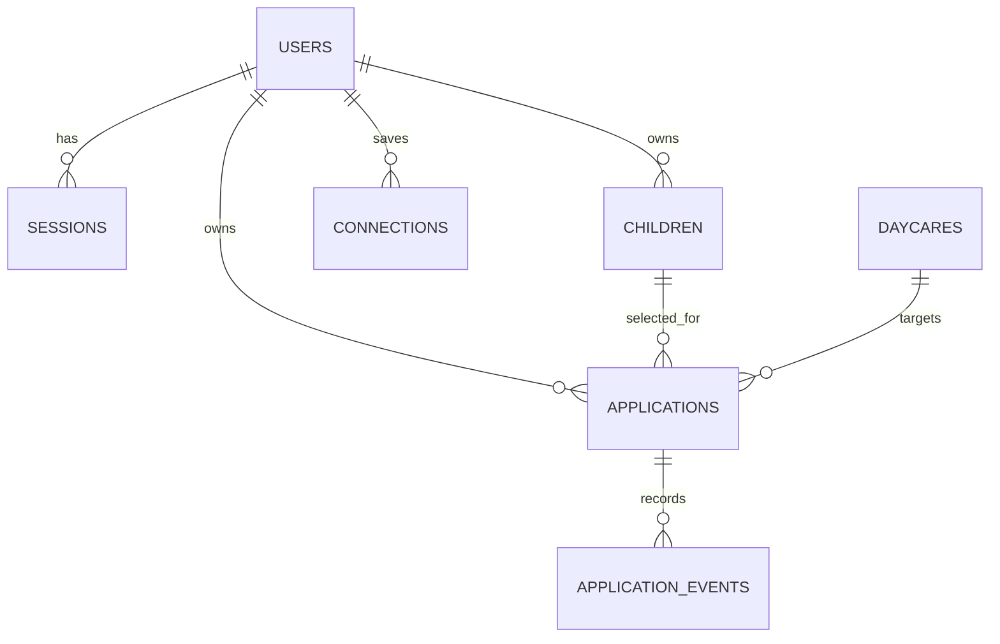

# OneKare MVP schema proposal

This is the lean database design for the current MVP. Only `users` and `sessions` are implemented today; the remaining tables are proposed.

## Scope

- Daycare search using BC data
- Parent accounts and children
- YWCA public forms
- YMCA saved-login forms
- Parkcrest email waitlist requests
- External application links and parent-reported status

## Relationships



Every table has `id`; all except `application_events` have `created_at` and `updated_at`. Foreign keys have indexes.

## users and sessions

Already implemented.

| Table | Columns |
| --- | --- |
| `users` | `email_address`, `password_digest`, `full_name`, `phone_number` |
| `sessions` | `user_id`, `ip_address`, `user_agent` |

`email_address` is normalized and unique. OneKare account passwords are only stored as a digest.

## children

```text
user_id
full_name
date_of_birth
```

Each child belongs to one user. All child queries are scoped to the logged-in user.

## daycares

Search records imported from BC data plus the configuration needed for the first integrations.

```text
source_facility_id
name
address
city
postal_code
latitude
longitude
website_url
application_url
application_email
phone
care_types                 JSONB
services                   JSONB
reported_vacancies         JSONB
vacancy_updated_at
application_type
support_status
integration_settings       JSONB
integration_version
mapping_updated_at
mapping_failure_reason
```

```text
application_type: external, public_form, authenticated_portal, email_only
support_status: unconfigured, enabled, needs_validation, paused
```

| Daycare | Application type | Support status |
| --- | --- | --- |
| YWCA | `public_form` | `needs_validation` |
| YMCA | `authenticated_portal` | `needs_validation` |
| Parkcrest | `email_only` | `enabled` after email validation |
| Other imported daycare | `external` | `unconfigured` |

`application_url` is saved only after verification. We never infer it from a daycare homepage.

## applications

One parent’s attempt to apply for one child at one daycare.

```text
user_id
child_id
daycare_id
channel
execution_status
outcome
outcome_source
form_data                  JSONB
prepared_content           JSONB
mapping_version
approved_at
approved_content_digest
operation_id               UUID
last_error
archived_at
```

```text
channel: external, onekare_form, onekare_email
execution_status: draft, ready_for_review, approved, executing, completed, failed, uncertain, needs_parent_input
outcome: not_submitted, submitted, waitlist_request_sent, waitlisted, offer_received, enrolled, rejected, offer_declined, withdrawn
outcome_source: automation, parent
```

`form_data` is a snapshot of normalized parent, child and eligibility information. `prepared_content` is the exact form answer set or email draft shown to the parent. Editing a profile later does not alter a saved application snapshot.

Execution status and outcome are separate. For example, a Parkcrest request can be `completed` with outcome `waitlist_request_sent`; it becomes `waitlisted` only when the parent reports confirmation.

## application_events

Append-only status and activity history. Fields: `application_id`, `event_type`, `previous_value`, `new_value`, `source`, `note`, and `occurred_at`.

`source` is `automation` or `parent`. Examples include `external_link_opened`, `mapping_changed`, `submitted`, `waitlist_request_sent`, and `outcome_reported`. Corrections create a new event rather than editing history.

## connections

One table holds YMCA login credentials and the parent’s connected mailbox. Its fields are `user_id`, `connection_type`, `provider_key`, `identifier`, `encrypted_secret`, `encrypted_metadata`, `status`, and `expires_at`.

`connection_type` is `provider_credentials` or `mailbox`. `encrypted_secret` stores either the saved provider password or mailbox refresh token. Secrets never appear in pages, logs, form data, events or AI prompts.

## Mappings and automatic updates

`daycares.integration_settings` contains mappings from normalized fields to a provider form or email template. It contains selectors, required fields, transformations, URLs and templates. It never contains credentials or executable scripts.

For example, a mapping can connect `parent.full_name` to `input[name='guardian_name']` and `child.date_of_birth` to `input[name='dob']` with a date transformation.

If a provider form changes, Databricks may generate a replacement mapping. The system automatically saves it only when every required field is mapped to a present, type-compatible, non-conflicting source value and the allowed domain has not changed. It increments `integration_version`, regenerates `prepared_content`, and clears `approved_at` and `approved_content_digest`. The parent then completes the normal final review again.

If no complete mapping is available, set the daycare to `needs_validation` or `paused`, save a safe failure reason, and offer the verified external application link. Never submit partial or guessed data.

## Required constraints

- Foreign keys for every owner and target column.
- Unique normalized `users.email_address`.
- Index `daycares.city`, `postal_code`, `application_type`, and `support_status`.
- Unique non-null `applications.operation_id` to prevent duplicate external execution.
- One active application per user, child and daycare, enforced with a partial unique index where `archived_at IS NULL`.
- Service validation confirms the selected child belongs to the application user.
- Parent outcome changes append an event and never trigger browser or email work.
- Only automation can set `waitlist_request_sent` or automation-confirmed `submitted`.
- Before execution, the digest of `prepared_content` must match `approved_content_digest`.

## Deferred tables

Add provider/centre/program tables, shared platform configuration, application revisions, approvals, execution attempts, browser sessions, handoff records and outbound-message records only when the MVP proves this lean model insufficient.

Migration order: `children`, `daycares`, `applications`, `application_events`, then `connections`.
