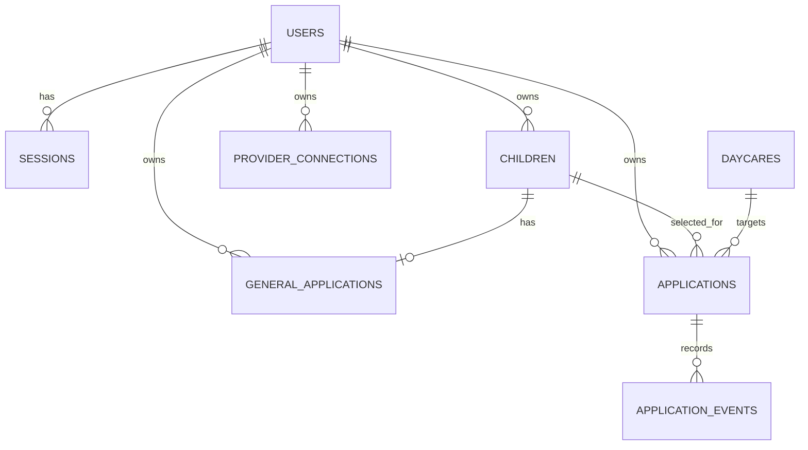

# OneKare MVP schema proposal

This is the lean database design for the current MVP. `users`, `sessions`, `children`, and `daycares` already exist. Migrations for `general_applications` and `provider_connections` are now included. The per-daycare submission and tracking tables remain proposed. The exact upfront questions are in [mvp-upfront-questions.md](mvp-upfront-questions.md).

## Scope

- Daycare search using BC data
- Parent accounts and children
- YWCA public forms
- YMCA saved-login forms
- Parkcrest email waitlist requests
- External application links and parent-reported status

## Relationships



Every table has `id`; all except `application_events` have `created_at` and `updated_at`. Foreign keys have indexes.

## users and sessions

The existing identity and contact fields are implemented. The central general application holds the actual upfront answer set. Account registration fields can prefill it, but do not silently replace answers supplied in the general application.

| Table | Columns |
| --- | --- |
| `users` | `email_address`, `password_digest`, `full_name`, `phone_number` |
| `sessions` | `user_id`, `ip_address`, `user_agent` |

`email_address` is normalized and unique. OneKare account passwords are only stored as a digest.

## children

```text
user_id
full_name
first_name
last_name
date_of_birth
expected_due_date
birthdate_unknown
birthdate_estimated
```

Each child belongs to one user. All child queries are scoped to the logged-in user. Children now support separate first and last names and a birthdate, expected due date, or an explicitly unknown birthdate. Existing child records with only `full_name` need a one-time name review; names are not split automatically. The central application refers to this child profile and does not copy its identity fields.

## daycares

Search records imported from BC data plus the configuration needed for the first integrations.

```text
source_facility_id
name
address
city
postal_code
latitude
longitude
website_url
application_url
application_email
phone
care_types                 JSONB
services                   JSONB
reported_vacancies         JSONB
vacancy_updated_at
application_type
support_status
integration_settings       JSONB, workflow settings and allowed default policy
integration_version
mapping_updated_at         last live mapping observation time
mapping_failure_reason
```

```text
application_type: external, public_form, authenticated_portal, email_only
support_status: unconfigured, enabled, needs_validation, paused
```

| Daycare | Application type | Support status |
| --- | --- | --- |
| YWCA | `public_form` | `needs_validation` |
| YMCA | `authenticated_portal` | `needs_validation` |
| Parkcrest | `email_only` | `enabled` after email validation |
| Other imported daycare | `external` | `unconfigured` |

`application_url` is saved only after verification. We never infer it from a daycare homepage.

## general_applications

One central application per parent and child, created before selecting any daycare:

```text
user_id
child_id
answers                   JSONB, canonical question keys and typed choices
created_at
updated_at
```

The unique `(user_id, child_id)` index prevents duplicate general applications for the same child. The form asks provider-neutral questions upfront. Each browser application freshly inspects the live provider form. It reuses the current configuration mapping if the field inventory is unchanged, or asks Databricks to update the mapping when the inventory differs. Uncollected provider-specific priority and marketing-SMS answers may default to No in the MVP. Eligibility answers such as catchment are never defaulted to Yes. A form that cannot be mapped stops before submission.

## applications (proposed per-daycare submissions)

One parent’s attempt to apply for one child at one daycare.

```text
user_id
child_id
daycare_id
channel
execution_status
outcome
outcome_source
form_data                  JSONB
form_observation           JSONB, current live questions and choices for browser runs
prepared_content           JSONB
form_fingerprint
mapping_snapshot            JSONB, configuration mapping used in this run
apply_requested_at
apply_request_id            UUID
operation_id               UUID
last_error
archived_at
```

```text
channel: external, onekare_form, onekare_email
execution_status: draft, preparing, needs_parent_verification, executing, completed, failed, uncertain
outcome: not_submitted, submitted, waitlist_request_sent, waitlisted, offer_received, enrolled, rejected, offer_declined, withdrawn
outcome_source: automation, parent
```

`form_data` is a snapshot of the completed general application and the selected child/daycare when the parent clicks Apply automatically. `form_observation` records the live questions and choices for browser runs; `mapping_snapshot` records the active configuration mapping used against that observation, and `form_fingerprint` identifies it. `prepared_content` is the exact form answer set or email message sent to the provider. Editing the general application later does not silently alter an existing submission.

Execution status and outcome are separate. For example, a Parkcrest request can be `completed` with outcome `waitlist_request_sent`; it becomes `waitlisted` only when the parent reports confirmation.

## Normalization and execution

The general application form stores stable answer keys and validated choice values. A later browser submission copies those values and inspects the current provider form. If the field inventory matches the saved inventory, it uses the current configuration mapping; if it differs, Databricks generates an updated mapping and the configuration is versioned. The workflow fills the currently observed controls and submits without a separate parent review. Observations and mappings are retained for audit and change comparison; previous form controls never drive a new run.

## application_events

Append-only status and activity history. Fields: `application_id`, `event_type`, `previous_value`, `new_value`, `source`, `note`, and `occurred_at`.

`source` is `automation` or `parent`. Examples include `external_link_opened`, `mapping_changed`, `submitted`, `waitlist_request_sent`, and `outcome_reported`. Corrections create a new event rather than editing history.

## provider_connections and future mailbox connections

`provider_connections` stores one encrypted YMCA portal credential set per parent: `user_id`, `provider_key`, `username`, and `encrypted_password`. It is created from Settings and is separate from general application answers. The password is write-only in the UI and encrypted with a key derived from the Rails secret key base.

A connected mailbox remains future work for Parkcrest sending. Its OAuth token should be stored separately from provider passwords. Secrets never appear in pages, logs, form data, events or AI prompts.

## Mappings and automatic updates

`daycares.integration_settings` contains workflow configuration: URLs, platform key, centre identifiers, current field inventory fingerprint and mapping, allowed default-answer policy, capabilities and email templates. Historical mappings are comparison records; stored field selectors are never trusted without fresh discovery. Configuration never contains credentials or executable scripts.

For example, the current run can map `parent.first_name` and `parent.last_name` to the live guardian-name fields and `child.date_of_birth` to the live birthdate field with a date transformation. Its target controls come from that run's inspection.

Databricks generates an updated mapping only when a freshly discovered field inventory differs from the saved inventory. Historical inventories reveal added, removed or changed questions and choices. The current form's required dropdowns can receive the agreed defaults drawn from their current choices. The current mapping is used only against controls found in the current run. A changed general application affects the next submission snapshot, not one already sent.

If the current form cannot be prepared, stop that application's execution before submission, save a safe failure reason and offer the verified external application link when available. Do not fall back to a historical mapping.

## Required constraints

- Foreign keys for every owner and target column.
- Unique normalized `users.email_address`.
- Index `daycares.city`, `postal_code`, `application_type`, and `support_status`.
- Unique non-null `applications.operation_id` to prevent duplicate external execution.
- One active application per user, child and daycare, enforced with a partial unique index where `archived_at IS NULL`.
- Service validation confirms the selected child belongs to the application user.
- Parent outcome changes append an event and never trigger browser or email work.
- Only automation can set `waitlist_request_sent` or automation-confirmed `submitted`.
- One `apply_request_id` identifies the parent's Apply automatically action and prevents duplicate dispatch from repeated clicks.

## Deferred tables

Add provider/centre/program tables, shared platform configuration, application revisions, execution attempts, browser sessions, handoff records and outbound-message records only when the MVP proves this lean model insufficient.

Migration order: existing `children` and `daycares`, then child birthdate options, `general_applications`, `provider_connections`, followed by per-daycare `applications`, `application_events`, and mailbox connections.
